# intel-arc-llm-stack

**Run any LLM — Gemma, Qwen3 MoE, gpt-oss, vision *and* audio — locally on an Intel Arc GPU, behind one OpenAI-compatible endpoint with hot-swapping, cost routing and a one-line installer.**

[](LICENSE)
[](https://github.com/dirtysouthalpha/intel-arc-llm-stack/actions/workflows/ci.yml)


<p align="center">
  
</p>

<p align="center">
  
</p>

Built and battle-tested on an **Intel Arc Pro B60 (24GB, Battlemage)** on Windows.

## Quickstart

On a Windows box with an Intel Arc GPU + Python 3.10+, from an **interactive** session (GPU compute
silently falls back to CPU in session-0 services — see sharp edges below):

```powershell
# 1. One-line install: IPEX-LLM SYCL + mainline Vulkan llama.cpp + llama-swap engines, a default
#    Gemma 3 model, the LiteLLM gateway, autostart tasks, firewall rule
iex "& { $(irm https://raw.githubusercontent.com/dirtysouthalpha/intel-arc-llm-stack/main/install.ps1) } -Root C:\arc-llm"

# ...or from a clone:
git clone https://github.com/dirtysouthalpha/intel-arc-llm-stack.git
cd intel-arc-llm-stack
.\install.ps1 -Root C:\arc-llm
```

The installer prints your endpoint + API key. Then, from any machine that can reach it:

```bash
curl http://<host>:4000/v1/chat/completions \
  -H "Authorization: Bearer $KEY" -H "Content-Type: application/json" \
  -d '{"model":"local-chat","messages":[{"role":"user","content":"hi"}]}'
```

Model aliases: `local-chat`, `local-vision`, `gemma-12b-max` (128K), `qwen3-30b` (MoE),
`gpt-oss-20b`, `qwen3-vl`, `omni` (audio), `local-coding`, and opt-in paid `coding`/`orchestration`.
Add/edit models in [`llama-swap/models.yaml`](llama-swap/models.yaml) and routing in
[`gateway/config.yaml`](gateway/config.yaml); `launchers/restart-stack.ps1` restarts the stack.

Size a context window before you pick one: `python vram-budget/vram_budget.py gemma3-12b --weights 6.8 --kv f16`.

## Hardware tested

Facts below come from [bench/results.md](bench/results.md) and [STATUS.md](STATUS.md); add your card via PR.

| GPU | OS / driver | Engine | Model | Result |
|---|---|---|---|---|
| Intel Arc Pro B60 24GB (Battlemage) | Windows, driver 32.0.101.8517, oneAPI 2025.1 | IPEX-LLM llama-server (SYCL, b20250729), `-ngl 999` | Gemma 3 12B Q4_K_M | 33.6 tok/s gen, pp512 84 tok/s, 49/49 layers on GPU; 128K ctx runs at ~31 tok/s; needle@16K PASS |
| Intel Arc Pro B60 24GB | same | IPEX-LLM **ollama** | Gemma 3 12B Q4_K_M | 0.8 tok/s (KV on CPU) — don't use |
| Intel Arc Pro B60 24GB | same | mainline llama.cpp **Vulkan** | gpt-oss-20b / Qwen3-VL-8B / Qwen2.5-Omni-7B | text MoE, vision, and exact audio transcription verified |

---

## Why this exists
The Intel Arc software stack for LLMs is young and full of sharp edges. This repo is the result of
working through every one of them so you don't have to — and packaging the result so anyone with an
Arc card gets a working multi-model server in one command.

## What you get
- 🧠 **MoE + dense reasoning** — Qwen3-30B-A3B, gpt-oss-20b, Gemma 3 12B/27B
- 👁️ **Vision** — Gemma 3, Qwen2.5-VL, Qwen3-VL (screenshots, OCR, visual Q&A)
- 🔊 **Audio** — Qwen2.5-Omni transcribes/understands speech
- 📜 **Huge context** — Gemma 3 12B at the **full 128K** window (needle-test verified)
- 💸 **Local-first cost routing** — everyday + vision stay free on the GPU; paid APIs are opt-in
- 🔌 **One OpenAI endpoint** — point any app/IDE/agent at it; models hot-swap on demand
- ♻️ **Autostart** — survives reboot via scheduled tasks

## How it works
```
your apps ──> LiteLLM gateway (:4000, cost routing) ──> llama-swap (:9090, hot-swap)
                                                          ├─ llama-server (IPEX SYCL)  Gemma/Qwen2.5
                                                          └─ llama-server (Vulkan)     gpt-oss/Qwen3-VL/Omni
                                                                      └─ Intel Arc GPU
```

## Benchmarks
Real measured throughput, quantization recipes, and MoE-vs-dense data for this exact stack live in the
companion repo **[intel-arc-llm-benchmarks](https://github.com/dirtysouthalpha/intel-arc-llm-benchmarks)**
(plus [bench/results.md](bench/results.md) here for the built-in throughput + 128K needle test).

## The sharp edges (so you skip the pain) — see [docs/](docs) + [bench/results.md](bench/results.md)
1. **GPU compute only works in an interactive session** (session 1), not a session-0 service —
   otherwise it silently falls back to CPU. The scheduled tasks use `LogonType Interactive`.
2. **Use `llama-server -ngl 999`, not IPEX-LLM *ollama*** — ollama's scheduler keeps the KV cache on
   CPU on big models (0.8 tok/s vs 33 tok/s).
3. **Use mainline GGUFs** (ggml-org/unsloth) — ollama's GGUFs fail to load in the IPEX build.
4. **IPEX SYCL build:** no flash-attn / no KV-quant (both crash) → f16 KV + small `-ub` for long ctx.
5. **Newer archs (gpt-oss, Qwen3-VL, Omni):** use the **mainline Vulkan** binary (enumerates only the
   Arc). gpt-oss: drop `-fa`. Qwen3-VL: add `-fit off`.
6. **Deploy configs with SCP**, not inline base64-over-SSH (truncates >~2KB). LiteLLM YAML must be ASCII.

## Layout
- `install.ps1` — the one-line installer.
- `vram-budget/` — max-`num_ctx` calculator (KV-cache + sliding-window aware).
- `launchers/` — start scripts (device-pinned to the Arc) + `restart-stack.ps1`.
- `llama-swap/models.yaml` — model definitions. `gateway/config.yaml` — LiteLLM cost routing.
- `bench/` — throughput + long-context needle test + results.
- `docs/` — vLLM/Vulkan notes, Sentinel-style router integration.

## License
MIT — built to help everyone with these cards. PRs welcome (more models, more Arc SKUs, perf tuning).

---

## Support this project

Built and maintained by one person, in the open. If it saves you time or
money, you can throw something in the hat — entirely optional, and it changes
nothing about the license or what ships.

<a href="https://cash.app/$vladien"></a>

**Cash App — [$vladien](https://cash.app/$vladien)**

Scan the code, or follow the link.

No tiers, no paywalled features, no "pro" build.

<br clear="left">

---
### More from Dirty South Alpha
*Self-hosted AI. Security-first. Always innovating.*

- 🎛️ [muse-maestro](https://github.com/dirtysouthalpha/muse-maestro) — guardrails, memory & cost telemetry for Meta Muse Code
- 🤖 [sentinel-code](https://github.com/dirtysouthalpha/sentinel-code) — multi-provider AI coding agent with smart model routing
- 📊 [intel-arc-llm-benchmarks](https://github.com/dirtysouthalpha/intel-arc-llm-benchmarks) — real Arc B60 inference numbers
- 🛠️ [msp-tier3-toolkit](https://github.com/dirtysouthalpha/msp-tier3-toolkit) — battle-tested MSP PowerShell
- 👤 [@dirtysouthalpha](https://github.com/dirtysouthalpha) — the full fleet

⭐ If this saved you time, star it and follow for more.

---
<p align="center"><sub><b>Dirty South Alpha™</b> · © 2026 · <a href="https://dirtysouthalpha.com">dirtysouthalpha.com</a> · self-hosted AI · security-first</sub></p>
